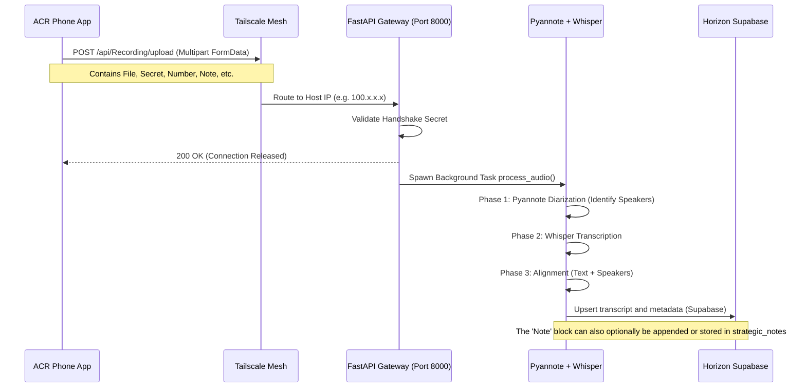

# ACR Phone Transcription Gateway: Windows Deployment Guide

This guide provides a strictly Windows-native setup for both the **HP Z2G3 Mini** (with CUDA support via Quadro M620) and the **Microsoft Surface Pro 3** (CPU-only).

---

## 1. Data Flow Architecture

The following diagram illustrates the flow of a call recording from the ACR Phone App through the Tailscale mesh, into the Python FastAPI Gateway, and ultimately structured for AI usage.



---

## 2. Deployment Checklist (PowerShell)

Run these PowerShell commands to prepare your Windows machines. 

### Step 2.1: Prerequisites (Both Machines)

Both machines require **Python 3.12**, **Git**, and **FFmpeg** (essential for audio manipulation natively on Windows).

```powershell
# 1. Install Chocolatey (if not already installed)
Set-ExecutionPolicy Bypass -Scope Process -Force; [System.Net.ServicePointManager]::SecurityProtocol = [System.Net.ServicePointManager]::SecurityProtocol -bor 3072; iex ((New-Object System.Net.WebClient).DownloadString('https://community.chocolatey.org/install.ps1'))

# 2. Install FFmpeg (Required for TorchAudio & Whisper alignment)
choco install ffmpeg -y

# 3. Navigate to Working Directory
cd C:\Users\owner\WORKPLACE\Horizon\mcp-backend

# 4. Create and activate a Virtual Environment
python -m venv venv
.\venv\Scripts\Activate.ps1
```

### Step 2.2: Machine-Specific PyTorch Installation

**Target 1: HP Z2G3 Mini (CUDA / Nvidia Quadro M620)**
The Quadro M620 supports CUDA. We want to leverage the GPU for rapid transcription.
```powershell
# Install PyTorch with CUDA 12.1 support
pip install torch torchvision torchaudio --index-url https://download.pytorch.org/whl/cu121
```

**Target 2: Surface Pro 3 (CPU-Only)**
The Surface Pro lacks an NVIDIA CPU and must run Pyannote/Whisper on the CPU.
```powershell
# Install standard CPU-only PyTorch
pip install torch torchvision torchaudio
```

### Step 2.3: Install Dependencies & Critical Pyannote Patch
Installing `pyannote.audio==3.1.1` is crucial on Windows, as the newer 4.0+ versions rely on a Linux-centric `torchcodec` that will cause a silent `NameError: AudioDecoder` crash during the pipeline phase.

```powershell
# Install FastAPI, Uvicorn, Faster-Whisper, and the Supabase client
pip install fastapi uvicorn python-multipart pydantic faster-whisper supabase

# Install stable Pyannote 3.1.x for native Windows/Torchaudio compatibility
pip install pyannote.audio==3.1.1
```
